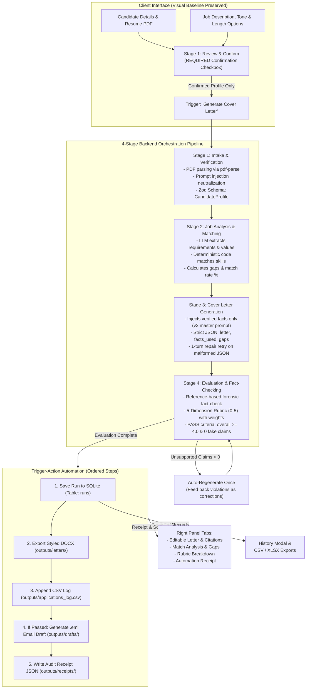

# System Architecture & 4-Stage Workflow Diagram

The diagram below illustrates the end-to-end architecture of the **AI Cover Letter Personalization Tool**, detailing the client interface, the 4-stage pipeline, deterministic verification gates, automated trigger-action actions, and persistent storage.

